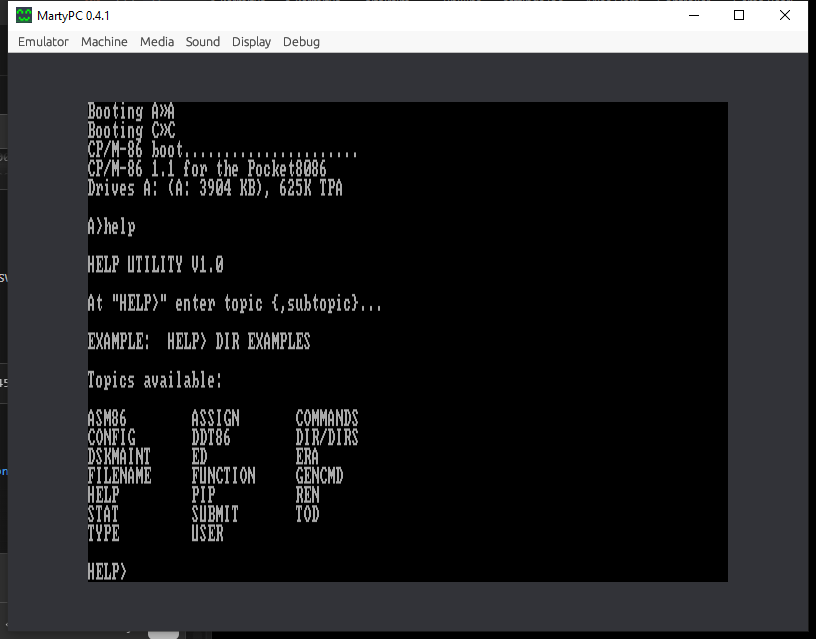

# pocket8086-cpm86

**Digital Research's CP/M-86 1.1, booting from the CF/SD card on the
Pocket8086.**



This is the 8086-native sibling of
[pocket8086-cpm](https://github.com/avantol/pocket8086-cpm), which runs CP/M-80
in the V30's 8080 mode. Here the CPU runs DR's original CP/M-86 1.1 CCP and
BDOS directly, with a new BIOS written for the Pocket8086 (or any XT-class PC).
DR's own IBM PC version of CP/M-86 1.1 only supported floppies.

* Boots straight from the card, with no DOS involved. Works with an NEC V30/V20
  or an Intel 8086/8088.
* The card holds up to four 8 MB CP/M drives (A:-D:); a 4 MB card gets one 3.8 MB drive.
* About 625K TPA. CP/M-86 uses all conventional memory.
* The console is a fast ADM-3A / Kaypro II style terminal, the same as in the
  CP/M-80 project.
* The card comes loaded with Digital Research software (on a 32 MB card):

| Drive | Contents |
|-------|----------|
| A: | CP/M-86 1.1 tools: ASM86, DDT86, ED, GENCMD, GENDEF, HELP, PIP, STAT, SUBMIT. Programmer's Utilities 1.1: RASM86 1.2, LINK86 1.4, LIB86, XREF86. Personal BASIC 1.1 (`BASIC`). `HELLO86.A86` sample. |
| B: | DR C 1.11 (`DRC`), with small and large model libraries and `HELLO.C` |
| C: | PL/I-86 1.0 (`PLI`), with DR's sample programs |
| D: | CBASIC Compiler CB86 2.0, with `HELLO.BAS`; and the CP/M-80 programs ASM, LOAD and DUMP with `HELLO80.ASM`, for VCPM (below) |

```
A>ASM86 HELLO86                 B>DRC HELLO
A>GENCMD HELLO86                B>A:LINK86 HELLO,CLEARS.L86[S]
A>HELLO86                       B>HELLO
Hello from CP/M-86 ...          Hello from DR C on the Pocket8086!

C>PLI DEMO                      D>CB86 HELLO
C>A:LINK86 DEMO                 D>A:LINK86 HELLO
C>DEMO                          D>HELLO
```

The CP/M-86 1.1 CCP only looks for programs on the current drive, hence
`A:LINK86`. On a 4 MB card only A: exists; the other drives' files are
skipped.

The IBM PC release's hardware-specific utilities (ASSIGN, CONFIG, DSKMAINT,
FUNCTION, SETUP, TOD) are not included, because they depend on IBM's BIOS or
floppy hardware. HELP still lists them as topics.

### VCPM: CP/M-80 programs on CP/M-86

[VCPM](http://www.cpm.z80.de/binary.html) (Stephen Hunt, 1988) runs CP/M-80
`.COM` programs under CP/M-86 by switching the V20/V30 into its 8080 mode, the
same trick the [pocket8086-cpm](https://github.com/avantol/pocket8086-cpm)
card uses for a whole system. It has no license statement, so it is not in
this repository: `python tools/get_vcpm.py` downloads the source into
`extras/`, and you build it on the machine:

```
A>ASM86 VCPM $PZSZ
A>GENCMD VCPM EXTRA[M1000]
A>D:
D>A:VCPM ASM HELLO80
D>A:VCPM LOAD HELLO80
D>A:VCPM HELLO80
```

VCPM needs an NEC V20/V30.

The CP/M-80 WordStar 3.30 from pocket8086-cpm (its `tools/get_wordstar.py`,
Kaypro II install) also runs under VCPM, because both cards use the same
console codes. Put its files in `extras/D/` and run `A:VCPM WS` from D:.

## Build and write a card

Requires Python 3 and [NASM](https://www.nasm.us/) (on the PATH, in
`tools/nasm-2.16.03/`, or set by the `NASM` environment variable).

```
python tools/build.py --sectors <card size in 512-byte sectors>
tools\writecard.ps1 -DiskNumber <n> -ExpectedSize <bytes>     # elevated PowerShell
```

Copy files to and from the card without rebuilding it (Windows, one UAC
prompt per command):

```
python tools/cpmfiles.py D: dir
python tools/cpmfiles.py D: put PROGRAM.CMD
python tools/cpmfiles.py D: get *.A86 -o backup
python tools/cpmfiles.py D: era OLD.CMD
python tools/cpmfiles.py D: sys build/cpm86.img     # new BIOS, files untouched
```

Files in `cpmfiles/` go onto A:, and files in `cpmfiles/B/`, `cpmfiles/C/`
and so on go onto those drives. A local `extras/` folder (ignored by git) is
copied the same way.

**Windows offers to "format" the card whenever it is inserted. Always click
Cancel.**

## How it works

| LBA   | Contents                                                   |
|-------|------------------------------------------------------------|
| 0     | boot sector + partition table (one entry, type DBh)        |
| 1-63  | CP/M-86 system: CCP+BDOS from DR's `CPM.H86`, then the BIOS |
| 64-   | CP/M drives A:, B:, ... (CP/M 2.2 file system)             |

* **`src/boot.asm`**: the boot sector. It loads the system image to
  0060:0000 and jumps to the BIOS `INIT` at 0060:2500.
* **`src/bios86.asm`**: the BIOS. CP/M-86 uses the "8080 model": CCP and
  BDOS at offsets 0000h-24FFh and the BIOS at 2500h, all in one segment.
  `INIT` sets the INT E0h vector to the BDOS, builds the memory region table
  from INT 12h, and starts the CCP.

  Unlike DR's sample BIOS, it leaves all other interrupt vectors alone, so the
  PC BIOS keeps working. Every BIOS entry that calls the PC BIOS switches to a
  private stack. Disk I/O maps 128-byte CP/M records onto 512-byte card
  sectors through a one-sector cache, with write-through.
* **`src/console.inc`**: a console that writes directly to video memory. It
  understands ADM-3A / Kaypro codes (cursor addressing, clear screen/line,
  insert/delete line, reverse and bright). The arrow keys send `^E ^X ^S ^D`.
* **`src/disk.inc`**: LBA-to-CHS conversion through INT 13h, plus the cache.
* **`tools/build.py`**: decodes `dr/CPM.H86`, plans the drives to fit the
  card, generates the disk parameter tables, assembles the BIOS and writes
  the image.

`dr/` keeps DR's original CP/M-86 1.1 system files for reference: `CPM.H86`,
the sample `BIOS.A86`/`CBIOS.A86`, `SINGLES.LIB` and `DEBLOCK.LIB`.

## Testing

Tested on a real Pocket8086 (NEC V30, 32 MB SD card), including DDT86, and
in [MartyPC](https://github.com/dbalsom/martypc) on an XT with XT-IDE:
boot, DIR, STAT, PIP, ED, HELP, ASM86 + GENCMD, and DDT86 trace/go. DR C,
PL/I-86, CBASIC (each compiled, linked with LINK86 1.4 and run), Personal
BASIC and VCPM (CP/M-80 ASM, LOAD and the result) were tested in MartyPC.

One emulator caveat: with MartyPC's NEC V20 CPU, DDT86's `T` and `G` commands
hang. DDT86 starts the program with an `IRET` whose flags word has bit 15
clear. On a V20/V30, that bit is the MD (8080 mode) flag, and MartyPC
(0.4.1) lets `IRET` change it. On a real V30, MD is write-protected unless
`BRKEM` enabled it, and DDT86 works fine. It also works on MartyPC's Intel 8088.

## Credits and licenses

* Original code (boot sector, BIOS, tools): MIT, see [LICENSE](LICENSE).
* CP/M-86 1.1 (`dr/` and the `.CMD` utilities) is by Digital Research,
  distributed under the DRDOS, Inc. grant in [CPM-LICENSE.txt](CPM-LICENSE.txt).
  It comes from [The Unofficial CP/M Web Site](http://www.cpm.z80.de/).
